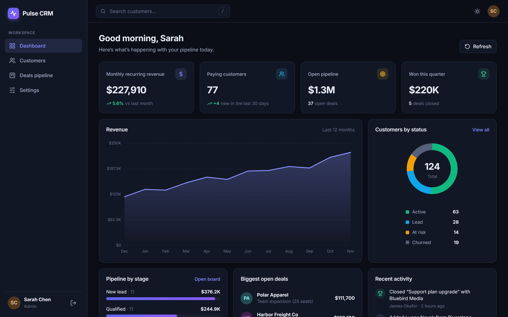
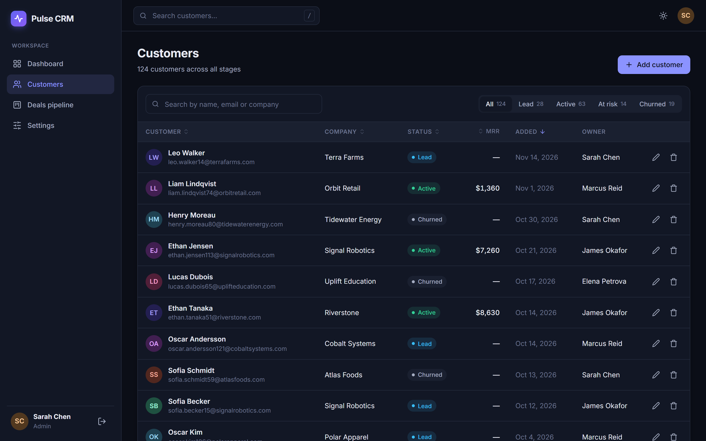
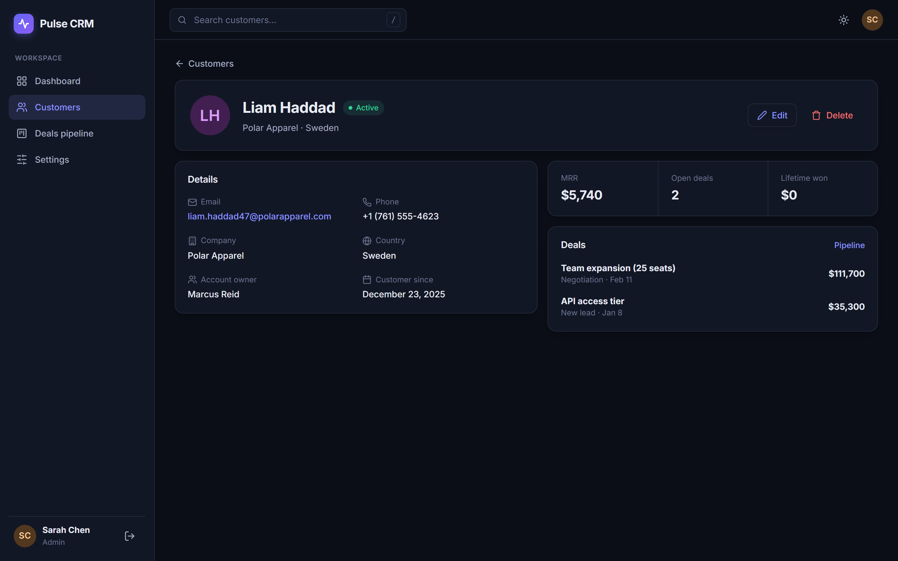
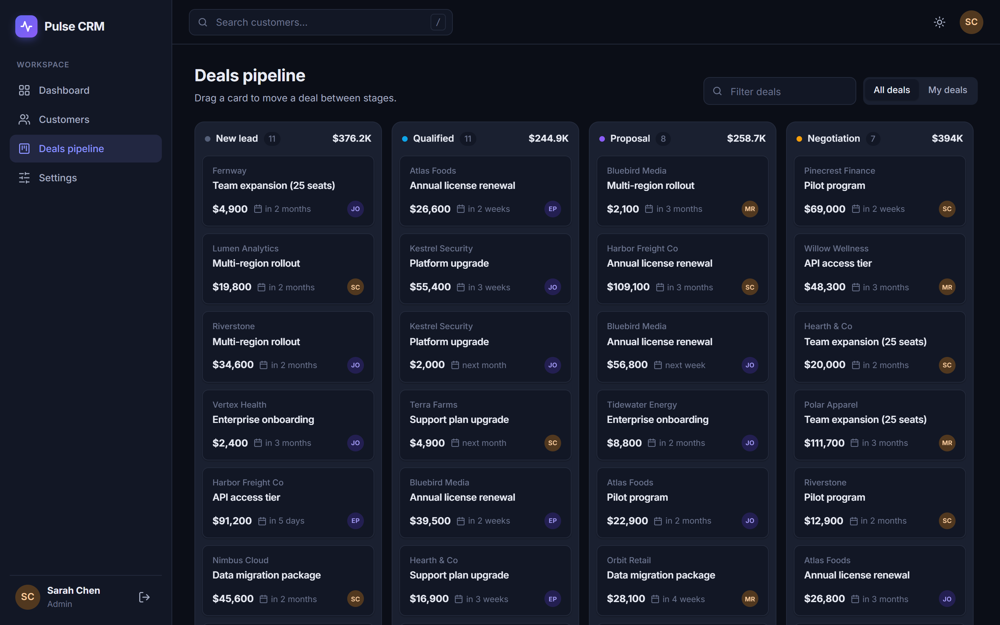
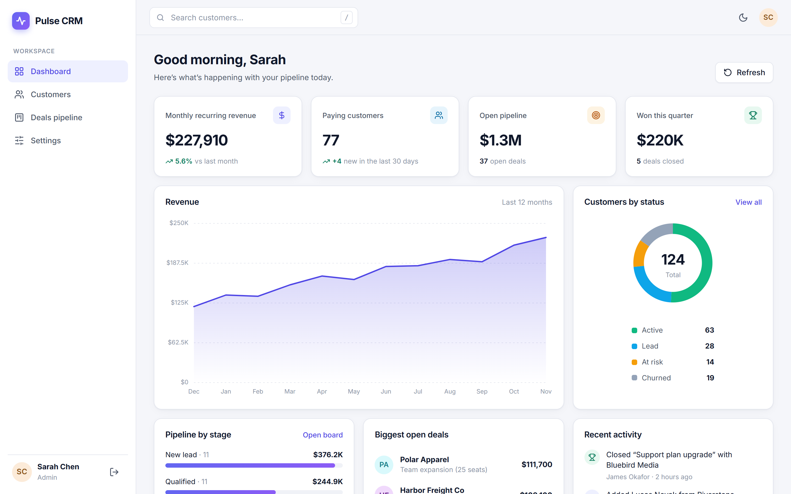
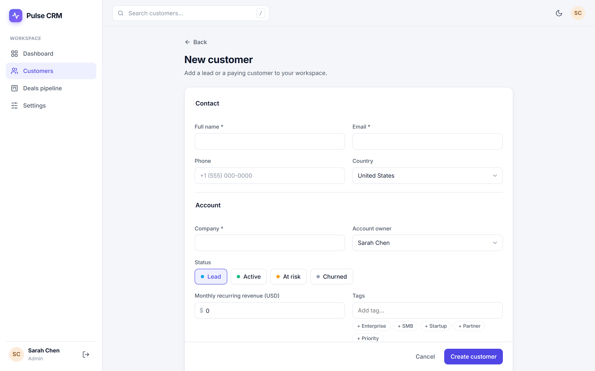
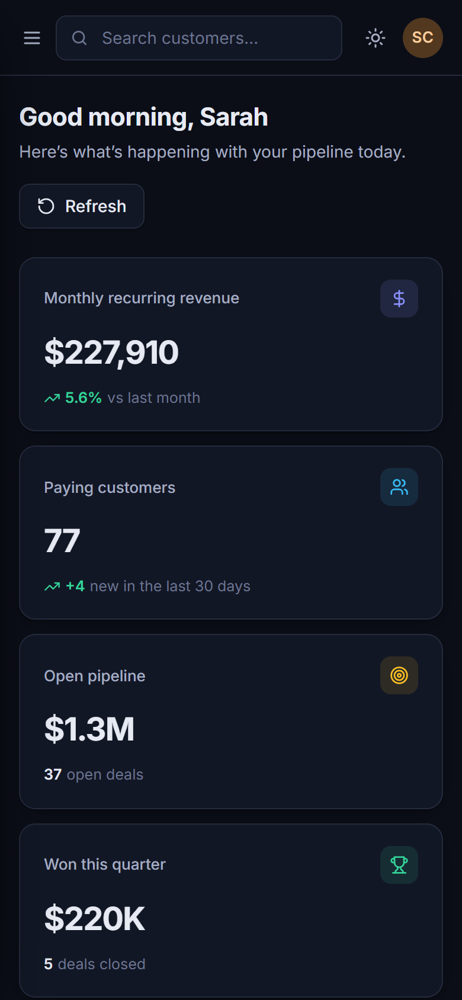

# Pulse CRM

A CRM admin dashboard built with **Angular 21**: customers, a drag-and-drop deals pipeline, revenue analytics and role-based access.

The backend is mocked inside the app (an HTTP interceptor that behaves like a REST API), so it runs with no server and can be deployed as a static site.



| Customers | Customer detail |
| --- | --- |
|  |  |

| Deals pipeline | Light theme |
| --- | --- |
|  |  |

| Customer form | Mobile |
| --- | --- |
|  |  |

## Demo accounts

| Role      | Email               | Password   |
| --------- | ------------------- | ---------- |
| Admin     | `admin@pulsecrm.io` | `demo1234` |
| Sales rep | `sales@pulsecrm.io` | `demo1234` |

The login page also has one-click buttons for both.

## Features

- **Dashboard**: KPI cards, a 12-month revenue chart, customers by status, pipeline by stage and an activity feed. The charts are plain SVG components with no chart library.
- **Customers**
  - Search, status filters, sorting and pagination, all kept in the URL so any view can be shared or bookmarked
  - Debounced search (RxJS `debounceTime` + `switchMap`, so stale requests are cancelled)
  - Detail page with the customer's deals
  - Create and edit form with typed reactive forms, an async "email already taken" validator, a cross-field rule (paying customers need MRR > 0), a tag input and an unsaved-changes guard
- **Deals pipeline**: Kanban board built on Angular CDK drag-and-drop, with optimistic updates that roll back if the API call fails
- **Auth & roles**: token interceptor, `authGuard`, `guestGuard` and `roleGuard('admin')`. Sales reps can't delete customers or open Settings, and the API rejects those requests too
- **Error handling**: loading skeletons, empty states, inline error and retry for reads, toasts for failed writes, auto sign-out on 401
- **Settings**: light/dark theme, plus switches to slow down the fake API or make about 30% of requests fail, so loading and error states are easy to try
- Responsive down to 360px, keyboard friendly (`/` focuses search), dark mode without a flash on load

## Tech stack

- Angular 21: standalone components, signals, `input()`, `rxResource`, the new control flow (`@if`, `@for`, `@let`), zoneless change detection, lazy-loaded routes
- RxJS for streams (search, URL-driven loading, async validation)
- Angular CDK (drag & drop)
- SCSS with CSS custom properties for theming
- TypeScript in strict mode

## Getting started

```bash
npm install
npm start
```

Open http://localhost:4200.

```bash
npm run build   # production build in dist/pulse-crm
```

## Project structure

```
src/app
├── core/                 # app-wide services, models, guards, interceptors
│   ├── auth/             # AuthService, guards, token interceptor
│   ├── http/             # error interceptor + helpers
│   ├── mock/             # fake REST backend + seeded data
│   └── api.ts            # typed API clients (customers, deals, stats)
├── shared/
│   ├── charts/           # SVG area + donut charts
│   ├── pipes/            # currency / relative time
│   └── ui/               # icon, avatar, badge, toasts, confirm dialog
├── layout/shell.ts       # sidebar + topbar
└── features/             # lazy-loaded pages
    ├── dashboard/
    ├── customers/
    ├── deals/
    ├── settings/
    └── login/
```

## Connecting a real API

All data goes through `HttpClient` to `/api/*`. To use a real backend, remove `mockBackendInterceptor` from `app.config.ts` and point the requests at your API (or add a dev proxy). The components don't need to change.
